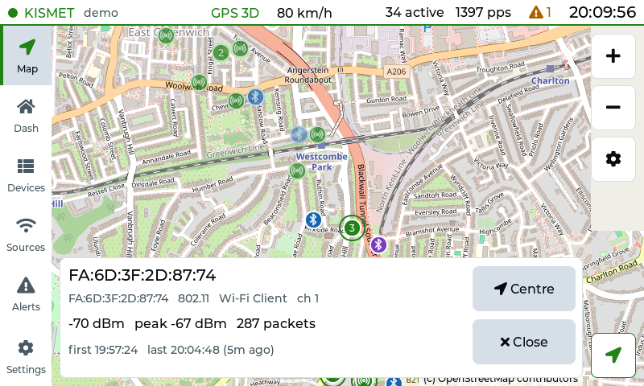
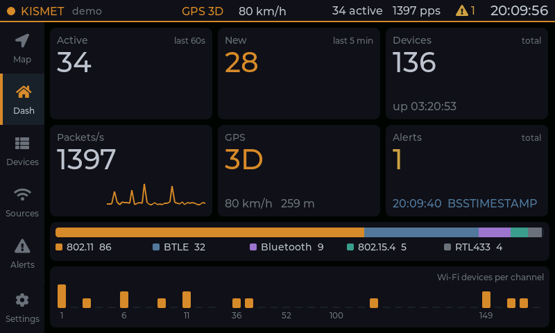

# kismet-crowpanel

A Kismet status display for the Elecrow CrowPanel 7.0" and 5.0" HMI ESP32
displays (ESP32-S3-WROOM-1-N4R8, 800x480 RGB panel, GT911 touch).  It would probably
compile to other devices.

The display uses a Go-based Kismet client which runs alongside the Kismet
server, and a firmware for the display panel which receives the data.  The
helper application handles formatting Kismet data, fetching and formatting
OpenStreetMap tiles, and serving it all over the serial port to the display.

## Hardware

This was written and tested on an Elecrow CrowPanel 7.0", but should work
equally well on the 5" version which shares the same resolution.  There's no
reason it shouldn't work on other ESP32-S3 based devices, but I haven't tested
it.

If you're looking for the panels, here's some Amazon affiliate links which help
Kismet out:

* [Elecrow 7 inch panel](https://link.amazon/B00SSMwh0)
* [Elecrow 5 inch panel](https://link.amazon/B0cON1TXO)

## Screenshots


| | |
|---|---|
|  |  |
| Map: devices by type and phy, clusters, own track | A device's details |
|  |  |
| Dashboard | Devices, strongest first |
|  |  |
| Sources with packets/s | Alerts |
|  |  |
| Settings | Dashboard in the Amber dark theme |
|  |  |
| Map in Amber | Map in Cyberpunk |

## Client

```sh
(cd client && go build)        # -> client/kismet-crowpanel
client/kismet-crowpanel --kismet http://localhost:2501 --apikey KEY --serial /dev/ttyUSB0
client/kismet-crowpanel --demo --serial auto           # synthetic data, no Kismet needed
```

`--serial /dev/ttyUSB0` pushes the UI to a panel on its USB-C port,
and `--serial auto` finds the panel itself (see below).  The panel's own log
output shows up in the client's log.  Nothing is served on the network
unless asked: `--listen ADDR` (port 8235, `--port`) serves the state document
at `/api/v1/state.json` for panels on Wi-Fi, and `--web` adds the browser
viewer at `/`.  The panel asks for map tiles and sends consent over the same
link (or over HTTP when it runs on Wi-Fi).  `--user`/`--password` work
instead of an API key.

Settings can also come from the environment, which is how the service
passes them; an option on the command line wins:

| Variable | Option | |
|---|---|---|
| `KISMET_URL` | `--kismet` | Kismet server (default `http://localhost:2501`) |
| `KISMET_APIKEY` | `--apikey` | Kismet API key |
| `KISMET_USER` | `--user` | Kismet login, with `KISMET_PASSWORD` |
| `KISMET_PASSWORD` | `--password` | Kismet password |
| `CROWPANEL_SERIAL` | `--serial` | the panel's port, or `auto` |
| `CROWPANEL_BAUD` | `--baud` | link rate to move the panel to, or `auto` (the default) |
| `CROWPANEL_NOTIFY` | `--notify` | socket for messages from local scripts (off by default) |

### Finding the panel

The panel's firmware starts its link at 115200 baud and sends a hello every
second until a client answers.  With `--serial auto` the client looks for
that hello:

- Only USB serial ports behind a panel's USB bridge are tried: the CH340
  (`1a86:7523`) and the CH9102 (`1a86:55d4`), picked from the USB IDs in
  sysfs on Linux, and from the port names (`cu.usbserial-*`,
  `cu.wchusbserial*`) on macOS.  Nothing is opened to pick them.
- Ports already in use are skipped: those with a UUCP lock file or a lock
  (`/proc/locks`), those open in another program (`/proc/*/fd` on Linux,
  `lsof` on macOS), and those another program holds exclusive, as gpsd does.
  A program run as another user only shows up through its locks and
  exclusive opens, so name the port if another CH340 device is attached.
- A port that doesn't answer gets its line settings back and is tried less
  often (up to once a minute) until it's replugged.
- The panel's port is then held exclusive, so nothing else (ModemManager
  probing, say) opens it.

Until the panel hears from a client, or when it stops hearing from one, it
shows a "Connecting" banner with what it's waiting for.

If a panel's bridge is on USB but has no serial port, the client says so: on
Ubuntu that's brltty claiming the CH340; remove brltty, or mask its udev
rule.

Once the panel has said hello, the client asks it for `--baud`; with `auto`,
the default, that's the fastest rate the firmware takes.  If the panel
refuses, can't be heard at that rate, or its frames keep failing their CRC
(3 in 30 seconds), the client steps down (2000000, 1500000, 921600, 460800,
230400) and stays at 115200 if none works.  Either side goes back to 115200
when the other goes quiet, so a restarted client or panel finds the other
again within a few seconds; finding a working rate can take a few tries at
startup.  The CH340 runs at 2000000 on both Linux and macOS, though on
macOS it garbles 921600; a `--baud 921600` there steps down to 460800.

### Notifications

Scripts on the client's machine can put a message on the panel (and the
web viewer).  With `--notify SOCKET` the client listens on a Unix socket,
which the service puts at `/run/kismet-crowpanel/notify.sock`, and
`kismet-crowpanel notify` sends to it:

```sh
kismet-crowpanel notify "Backup finished"
kismet-crowpanel notify --level warn --title Disk "/var/log is 95% full"
kismet-crowpanel notify --level alert --secs 0 "GPS fix lost"
df -h / | tail -1 | kismet-crowpanel notify --title "Root disk"
```

`--level` is `info`, `warn` or `alert`, which picks the message's colour;
`--secs` is how long it shows (10 by default, 0 until the next message).
Messages show one at a time, in the order sent; tap one to dismiss it.  With
no text on the command line, each line of stdin is a message.  `--socket`
(or `$CROWPANEL_NOTIFY`) names another socket.

Without the helper, write a line to the socket: plain text, or a JSON
object with `text` and optionally `title`, `level` and `secs`.  Each line
gets back `ok ID` or `error: why`:

```sh
echo '{"text":"Survey done","level":"info","secs":30}' | nc -U /run/kismet-crowpanel/notify.sock
```

Any local user can write to the socket.  Text is cut at 159 bytes, titles
at 47.

## Map tiles

The client follows Kismet's map tile setting (`httpd_map_tile_url`,
`httpd_map_tiles` in `kismet_httpd.conf`; no URL means OpenStreetMap) and,
like Kismet's web UI, asks before using a tile server.  Tiles are fetched
only when viewed, cached in `--cache-dir` (default `~/.cache/kismet-crowpanel`,
`--tile-cache-mb` cap), and served to the panel as palette PNGs re-coloured
for each theme (Cyberpunk, for one, draws roads in neon).  `--no-map` turns
it off.

- `GET /api/v1/map.json`: tile server, mode, consent state
- `POST /api/v1/map/consent` `{"url": ..., "allow": true}`
- `GET /api/v1/tiles/<skin>/<z>/<x>/<y>.png[?cached=1]`, skin one of
  classic, amber, ocean, sunlight, red, cyberpunk (`cached=1`: from the
  cache only, 404 if not there)

The Map page follows the GPS fix north-up, zooms by speed (17 in town, 16
above 30 km/h, 15 above 70), and looks ahead along the heading when moving.
Between fixes it moves along your heading and speed, so following is
smooth.  Drag to pan, pinch (or mouse wheel in the viewer) to zoom;
following resumes 20 s later, or at once with the locate button.  When Kismet is set to ask, the page shows a consent prompt; "Not
now" can be undone from the chip at the top left.  In the web viewer, tiles
are fetched from the same client as the state document.

Devices are plotted where Kismet saw their strongest signal (or their
average location when Kismet has no peak), with Kismet's icon for their
type, coloured by phy and fading with time since last seen; ones first seen
in the last minute blink a ring.  Aircraft and vessels are drawn at the
position they report (ADS-B, AIS), turned to their heading.
Close devices cluster into numbered bubbles; tap one to zoom in, or tap a
device for its details.  The grey line is your own track.

The gear button on the map opens map options: which phys to show, and
whether to show all devices, the last hour, the last 10 minutes or only new
ones (first seen in the last minute).  The button is
outlined while a filter hides anything.  When the
view is loaded and you're moving, the panel also asks for tiles on the road
ahead, from the client's cache only: prefetching never goes to the tile
server.

- `GET /api/v1/markers?z=&lat=&lon=&w=&h=[&phy=&new=&age=]`: devices
  around a view (binary, format in `client/markers/markers.go`)
- `GET /api/v1/track`: own track (binary)
- `GET /api/v1/device/<id>.json`: one device's details

## Settings

The Settings tab (bottom of the rail) has:

- Mode: Light, Dark or Auto.  Auto switches at sunrise and sunset (worked
  out by the client from the GPS fix) or at set times on the client's clock.
- Light theme: Classic, Ocean, Sunlight (black on white, for glare).
- Dark theme: Amber, Red (only reds, map included, for night vision),
  Cyberpunk.
- Units: metric or imperial (speed, distance, map scale).
- Backlight level for light and dark.

The panel keeps settings in flash; the web viewer keeps them in the
browser.

## Web viewer

```sh
web/build.sh          # emscripten -> web/dist
client/kismet-crowpanel --demo --listen 127.0.0.1 --web
# open http://localhost:8235/
```

The viewer renders RGB565 like the panel and takes mouse input as touch.
URL options: `?page=map|dash|devices|sources|alerts|settings`, `?theme=auto|day|night`,
`?interval=ms`, `?state=URL`, `?backlight=1` (dim the canvas like the
panel's backlight).

Be sure not to leave the web viewer enabled on an insecure LAN; it's meant
for testing the configuration, and may expose your Kismet data (location, nearby
devices, etc).

## Installing the client

```sh
./configure --prefix=/usr --sysconfdir=/etc    # usual autoconf-style paths
make && sudo make install                      # make install-web for --web
sudo systemctl daemon-reload && sudo systemctl enable --now kismet-crowpanel
```

The service runs the client as a locked-down dynamic user in the `dialout`
group (`uucp` on Arch), with its settings in
`SYSCONFDIR/kismet-crowpanel/kismet-crowpanel.conf`.  The file is mode 0600 since
it holds the Kismet login, and `make install` never replaces it.  Every
setting is a variable:

```sh
KISMET_URL=http://localhost:2501
KISMET_APIKEY=                    # an API key, or
KISMET_USER=kismet                # a user and password
KISMET_PASSWORD=secret
CROWPANEL_SERIAL=auto             # or /dev/serial/by-id/usb-1a86_USB_Serial-if00-port0
CROWPANEL_BAUD=auto               # or a rate, as --baud
CROWPANEL_NOTIFY=/run/kismet-crowpanel/notify.sock   # empty: no notifications
CROWPANEL_ARGS="--listen 127.0.0.1 --web"   # any other options
```

A `/dev/serial/by-id/` path names the panel's port in a way that survives
replugs, and is the safe choice when other CH340 devices are attached (see
"Finding the panel").  Restart the service after changing the file:
`sudo systemctl restart kismet-crowpanel`, and `journalctl -u kismet-crowpanel`
shows its log, the panel's log lines included.

`make install` also puts the prebuilt panel firmware in
`DATADIR/kismet-crowpanel/firmware`, where `kismet-crowpanel flash` looks
first; packages that build with plain `go build` should install it in
`PREFIX/share/kismet-crowpanel/firmware`, beside the binary's `bin/`.

## Firmware

Prebuilt images for both boards are in `firmware/prebuilt/` (USB serial
link, starting at 115200 baud).  The client flashes them itself, no PlatformIO or
esptool needed:

```sh
client/kismet-crowpanel flash --port /dev/ttyUSB0
client/kismet-crowpanel flash --port /dev/ttyUSB0 --board crowpanel5   # first install
```

With no `--board` it restarts the panel and asks the firmware already on it
which board it is (trying the link at 115200, then the 921600 and 460800
of older firmware, or `--link-baud`).  That needs this project's firmware; the first time, over
Elecrow's demo, give `--board crowpanel7` or `--board crowpanel5`.
`--dry-run` shows what it would flash.

The board is reset into its ROM loader through the USB port's DTR/RTS
lines; if that fails, hold BOOT while pressing RESET.  `--image FILE` (and
`--address 0x10000` for an app image alone) flashes your own build;
`--baud` sets the flashing speed (460800 by default).

To build your own:

```sh
cp firmware/include/widget_config.example.h firmware/include/widget_config.h
# link = transport::serial by default; transport::wifi needs the SSID and state URL
firmware/build.sh --net     # first build fetches the toolchain; later builds offline
(cd firmware && pio run -e crowpanel5)   # the 5.0" board
firmware/prebuild.sh        # the images in firmware/prebuilt
```

Pins and panel timings follow Elecrow's examples for each board.  On v3.0
boards the touch controller is reset through a PCA9557; the firmware detects
that at startup.


## License

GPL v2 or (at your option) any later version; see `LICENSE`.  The device
icons are drawn from Kismet's, also GPL.
